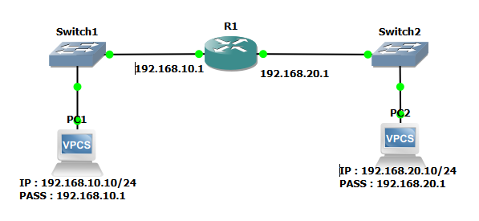

# LAB02 — Interconnexion de deux sous-réseaux avec Cisco 2691

## 1. Présentation

Ce laboratoire a pour objectif de mettre en œuvre une communication entre deux sous-réseaux IPv4 à l'aide d'un routeur Cisco 2691 dans GNS3.

Le laboratoire permet de pratiquer la configuration des interfaces réseau, le routage entre réseaux directement connectés, la vérification de la connectivité et l'analyse des paquets avec Wireshark.

## 2. Objectifs pédagogiques

- Concevoir une topologie réseau comportant deux sous-réseaux.
- Configurer les interfaces d'un routeur Cisco.
- Attribuer des adresses IPv4 aux postes clients.
- Définir les passerelles par défaut.
- Tester la connectivité locale et inter-réseaux.
- Observer les échanges ARP et ICMP avec Wireshark.
- Préparer le laboratoire à une future expérimentation avec des ACL.

## 3. Environnement technique

| Élément | Description |
|---|---|
| Système hôte | Windows 11 Professionnel |
| Émulateur réseau | GNS3 2.2.61 |
| Routeur | Cisco 2691 |
| Commutateurs | Switches Ethernet GNS3 |
| Postes clients | VPCS |
| Analyse réseau | Wireshark |

## 4. Topologie

PC1 — Switch 1 — Routeur Cisco 2691 — Switch 2 — PC2

*Insérer ici la capture de la topologie GNS3.*

## 5. Plan d'adressage IPv4

| Équipement | Adresse IPv4 | Masque | Passerelle |
|---|---|---|---|
| PC1 | 192.168.10.10 | 255.255.255.0 | 192.168.10.1 |
| R1 — interface LAN 1 | 192.168.10.1 | 255.255.255.0 | — |
| R1 — interface LAN 2 | 192.168.20.1 | 255.255.255.0 | — |
| PC2 | 192.168.20.20 | 255.255.255.0 | 192.168.20.1 |

*Vérifier que ce tableau correspond aux adresses réellement configurées dans le laboratoire.*

## 6. Principe de fonctionnement

Le routeur possède une interface dans chacun des deux sous-réseaux. Il peut donc acheminer les paquets entre ces réseaux dès lors que les interfaces sont opérationnelles et que les postes utilisent les bonnes passerelles.

Lorsqu'un poste souhaite communiquer avec une adresse située dans un autre sous-réseau, il transmet le paquet à sa passerelle par défaut. Le routeur examine ensuite sa table de routage pour choisir l'interface de sortie.

## 7. Vérifications et tests

### 7.1 Vérification des interfaces du routeur

Commande :

`show ip interface brief`

Cette commande permet de vérifier les adresses IP et l'état des interfaces.

*Insérer ici la capture du résultat.*

### 7.2 Vérification de la table de routage

Commande :

`show ip route`

Les deux réseaux directement connectés doivent apparaître dans la table lorsque leurs interfaces sont opérationnelles et correctement adressées.

*Insérer ici la capture du résultat.*

### 7.3 Tests de connectivité

Les tests réalisés sont les suivants :

- PC1 vers sa passerelle : 192.168.10.1.
- PC2 vers sa passerelle : 192.168.20.1.
- PC1 vers PC2 : 192.168.20.20.
- PC2 vers PC1 : 192.168.10.10.

*Insérer les captures des résultats réels des commandes ping.*

## 8. Analyse Wireshark

Une capture a été réalisée afin d'observer les communications générées pendant les tests.

Les protocoles à examiner sont :

- **ARP** : résolution de l'adresse MAC associée à une adresse IPv4 sur le réseau local.
- **ICMP Echo Request** : requête envoyée par la commande ping.
- **ICMP Echo Reply** : réponse au ping.

Pour un échange entre deux sous-réseaux, les adresses IP source et destination restent normalement celles des deux postes. En revanche, les adresses MAC utilisées sur chaque liaison correspondent au prochain saut local ; elles changent donc lorsque le paquet traverse le routeur.

*Insérer ici une capture Wireshark montrant les paquets ARP et ICMP.*

## 9. Résultats

Les tests de connectivité réalisés ont abouti à des réponses positives entre les passerelles et entre les postes des deux sous-réseaux.

Le laboratoire permet ainsi de valider la configuration de base du routage IPv4 entre deux réseaux distincts.

Les captures d'écran et les sorties de commandes seront ajoutées pour documenter les résultats observés.

## 10. Améliorations envisagées

La prochaine évolution consistera à configurer une ACL IPv4 sur le routeur afin de contrôler les communications entre les deux sous-réseaux.

Des tests seront réalisés avant et après l'application de la règle pour vérifier son effet sur le trafic autorisé et bloqué.

## 11. Conclusion

Ce laboratoire constitue une première mise en pratique du routage IPv4 avec un routeur Cisco émulé dans GNS3. Il associe configuration, validation de la connectivité et observation des échanges réseau.

Il servira de base à des travaux ultérieurs sur les listes de contrôle d'accès, le filtrage des flux et l'analyse de la sécurité réseau.